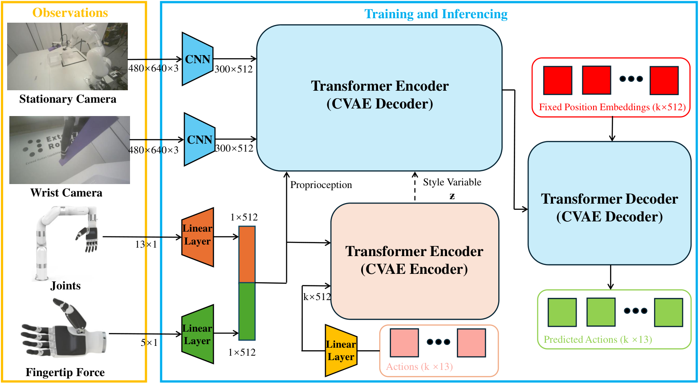
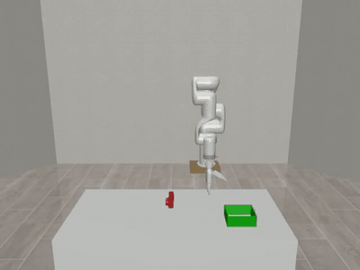
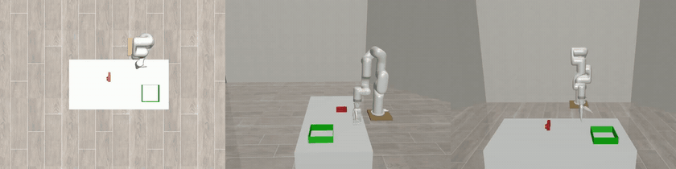
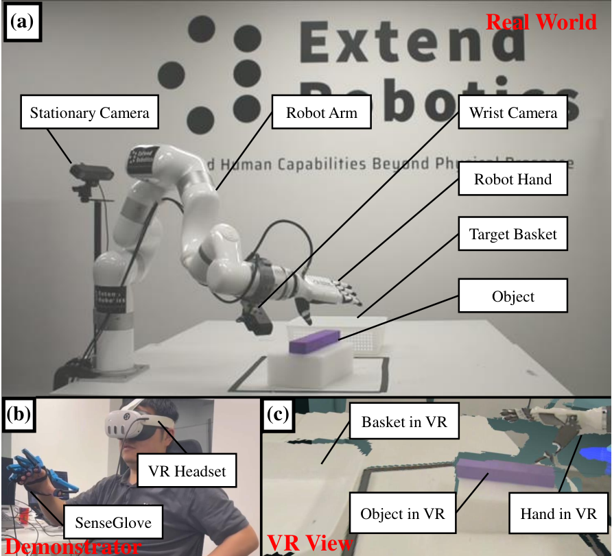
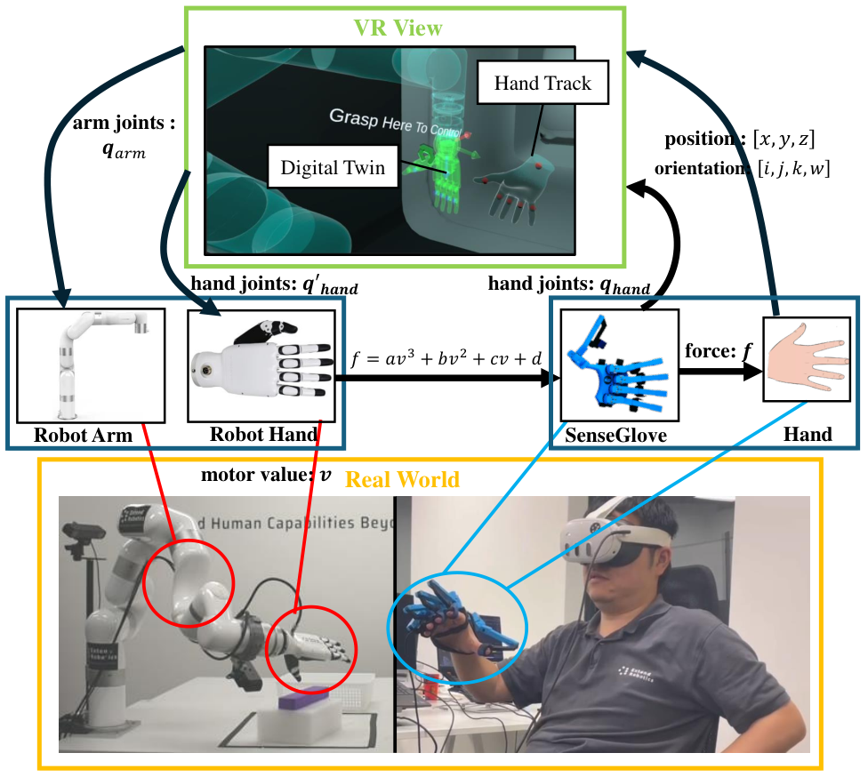
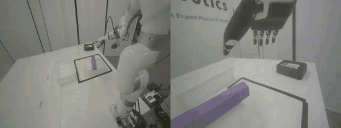
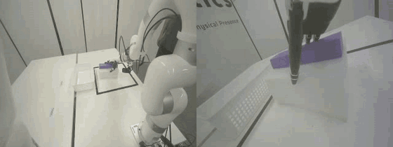
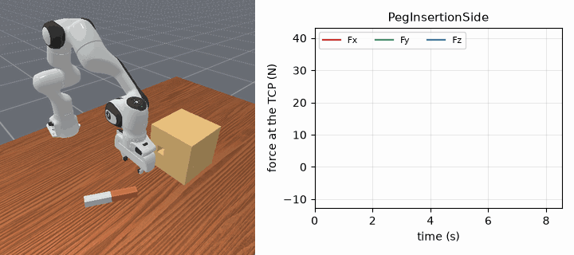
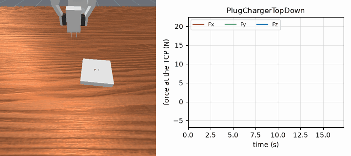
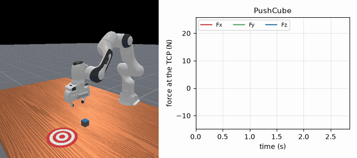

# Haptic-ACT: Bridging Human Intuition with Compliant Robotic Manipulation via Immersive VR

<p align="center">
  <a href="https://arxiv.org/abs/2409.11925"></a>
  <a href="https://github.com/KelinLi-ReCAST/Haptic-ACT"></a>
  <a href="https://huggingface.co/datasets/KelinLiIC/Haptic-ACT"></a>
  <a href="https://sites.google.com/view/hapticact"></a>
</p>

Code for the paper [*Haptic-ACT: Bridging Human Intuition with Compliant Robotic Manipulation via Immersive VR*](https://arxiv.org/abs/2409.11925) (Kelin Li, Shubham M Wagh, Nitish Sharma, Saksham Bhadani, Wei Chen, Chang Liu and Petar Kormushev, IEEE/RSJ IROS 2025). Project page: [sites.google.com/view/hapticact](https://sites.google.com/view/hapticact).

The repository contains the simulation side of the work: a MuJoCo model of the xArm7 arm with the Inspire dexterous hand, the demonstrations of the pick-and-place task, the Haptic-ACT policy, and the original ACT as the baseline, both trained and evaluated on the same data. It also contains the SenseGlove interface, a MuJoCo teleoperation script driven by the glove, a Unity project that loads the MuJoCo scene, and a loader for the real-robot recordings.

Haptic-ACT extends [ACT](https://github.com/tonyzhaozh/act) (Action Chunking with Transformers) with the fingertip forces of the hand. The observation is the camera image, the 13 joint positions (7 arm, 6 hand) and the 5 fingertip forces; the output is a chunk of 13-d joint targets. In the code the forces enter the network twice: they are concatenated with the joint positions into an 18-d proprioceptive input of the transformer, and they are added as an extra token to the input of the CVAE encoder that computes the style variable during training.

<p align="center">
  
</p>

| Demonstration (`frontview`) | Haptic-ACT rollout (`birdview`, `sideview`, `frontview`) |
|:---:|:---:|
|  |  |

*Pick-and-place in MuJoCo: the xArm7 with the Inspire hand picks up the object and places it in the green basket (2× speed).*

---

## 1. Hardware

Training and the simulation experiments need only a PC. The other components belong to the real-robot setup (§6).

| Component | Role | Notes |
|---|---|---|
| Linux PC with an NVIDIA GPU | Runs MuJoCo, trains and evaluates the policies | The paper used an RTX 3070 Ti for the simulation and an RTX 4070 for the real-robot policies. `imitate_episodes.py` requires CUDA |
| xArm7 + Inspire dexterous hand | Follower robot: 7 arm joints and 6 hand joints (thumb yaw, thumb pitch, index, middle, ring, pinky) | Modelled in MuJoCo (`simulation/assets/robot_sim/`); the real robot is used in §6 |
| Meta Quest 3 | Tracks the demonstrator's wrist pose and shows the robot's view in VR | Real robot only |
| SenseGlove | Finger joint sensing and per-finger force feedback | Used in the real setup and, optionally, for MuJoCo teleoperation (§4, Step 5) |
| 2× ZED RGB-D cameras | One stationary, one on the wrist | Real robot only; the simulation uses a rendered front camera |

<p align="center">
  
  &nbsp;
  
</p>

*Left: the immersive VR setup: (a) the xArm7 and Inspire hand following the demonstrator, (b) the demonstrator with the Quest 3 and the SenseGlove, (c) the view in the headset. Right: data flow. The wrist pose from the Quest 3 is converted to arm joints by a Unity digital twin, the glove joints are mapped to the hand, both are sent over ROS, and the hand's force readings are rendered back to the fingers through the SenseGlove.*

| Demonstration with SenseGlove (front / wrist camera) | Haptic-ACT on the real robot (front / wrist camera) |
|:---:|:---:|
|  |  |

*Real-robot pick-and-place, 400 steps recorded at 15 Hz (shown at 3× speed).*

---

## 2. Repository layout

`haptic_act/` and `act_baseline/` share the same structure and differ only where the force is used: `detr/models/detr_vae.py`, `policy.py`, `utils.py` (data loading and normalisation), `imitate_episodes.py` and `record_sim_episodes.py` (force logging), and the waypoints of `scripted_policy_xarm.py`. Both are derived from [ACT](https://github.com/tonyzhaozh/act); `detr/` is modified from [DETR](https://github.com/facebookresearch/detr) and keeps its Apache 2.0 licence. The objects in `simulation/assets/object_sim/` are from [object_sim](https://github.com/vikashplus/object_sim) (own licence in that folder) and the xArm7 model is adapted from [MuJoCo Menagerie](https://github.com/google-deepmind/mujoco_menagerie).

```
environment.yml                          conda environment "haptic-act" (PyTorch 1.12, CUDA 11.3)
environment_cu128.yml                    conda environment "haptic-act-cu128" for recent GPUs (PyTorch 2.11, CUDA 12.8)
haptic_act/                              Haptic-ACT (images + joint positions + fingertip forces)
  constants.py                           task configuration (dataset path, 50 episodes, 400 steps, camera)
  ee_env_xarm.py                         MuJoCo env with end-effector (mocap) control, used by the scripted policy
  env_xarm.py                            MuJoCo env with joint position control, used for recording and evaluation
  scripted_policy_xarm.py                waypoint policy for pick-and-place
  record_sim_episodes.py                 generates the demonstrations (HDF5)
  imitate_episodes.py                    training and evaluation
  policy.py                              ACTPolicy / CNNMLPPolicy wrappers
  utils.py                               episodic dataset, normalisation statistics, object pose sampling
  visualize_episodes.py                  video and joint plots of a recorded episode
  data_preprocessing.py                  template for converting recorded arrays into the HDF5 format
  detr/                                  transformer, CVAE and backbone (models/detr_vae.py holds the force input)
act_baseline/                            original ACT on the same task (images + joint positions)
simulation/
  assets/
    robot_sim/                           xarm7_inspire.xml, inspire_hand_only.xml, meshes
    env_sim/                             room, table, lights, cameras
    object_sim/                          object models
    manipulation_tasks/                  pick_and_place.xml, pick_and_place_ee.xml, keyboard_control.xml
  scripts/
    keyboard_control.py                  keyboard teleoperation of the arm (mujoco_py)
    keyboard_control_senseglove.py       keyboard for the arm, SenseGlove for the hand
    demo.py                              variant of keyboard_control.py with a different hand start pose
  unity/                                 Unity 2021.3 project that imports the MuJoCo scene (MuJoCo Unity plug-in)
    Assets/Scripts/                      Joints.cs, RGB.cs, Depth.cs: save actuator commands and camera images
senseglove/
  sg.py                                  calibration, glove-to-hand joint mapping, force-to-PWM conversion
  senseglove_feedback.py                 calibrates the glove and streams the mapped hand joints
  lib/                                   libsenseglove.so and the SenseGlove SDK libraries (Linux)
real_robot/
  data_extract.py                        loader for the compressed real-robot HDF5 episodes
media/readme/                            images used in this README
ft_maniskill/                            Haptic-ACT adapted to a force/torque sensor, in ManiSkill (§8)
  policy/lerobot_policy_acthaptic/       the policy, as a LeRobot plugin (--policy.type=acthaptic)
  train/train_acthaptic.py               lerobot-train entry point of the policy
  eval/eval_ft.py                        evaluation (10 seeds x 25 trials)
  dataset_processing/                    force columns, F/T window, stats, force-free copy
  requirements.txt                       Python 3.12 environment
```

Datasets and checkpoints are on Hugging Face; see §3.3.

---

## 3. Installation

### 3.1 Conda environment

```bash
conda env create -f environment.yml    # Python 3.8, PyTorch 1.12 (CUDA 11.3), MuJoCo 2.3.7, dm_control 1.0.14
conda activate haptic-act
```

PyTorch 1.12 with CUDA 11.3 does not run on recent GPUs (RTX 40 series and newer). For those, use the second environment, which has Python 3.10 and PyTorch 2.11 with CUDA 12.8 and keeps the other packages; the pipeline of §4 has been run with it:

```bash
conda env create -f environment_cu128.yml
conda activate haptic-act-cu128
```

Keep MuJoCo 2.3.7 with dm_control 1.0.14. MuJoCo 3.1.6 compiles the scene, but the scripted policy does not reach the object there (the mocap weld that drives the end effector behaves differently), so no demonstration passes the filter of Step 1.

`detr/` does not have to be installed. `imitate_episodes.py` adds its own `detr/` to `sys.path`, and `policy.py` imports `detr` from the working directory, so the scripts are started from inside `haptic_act/` or `act_baseline/`. Do not `pip install -e` either copy of `detr/`: the two packages have the same name and different models.

Offscreen rendering uses EGL (`MUJOCO_GL=egl` is set at the top of `imitate_episodes.py`). Set `MUJOCO_GL=egl` in the shell as well when running `record_sim_episodes.py` on a machine without a display.

### 3.2 Optional packages

| Needed for | Install |
|---|---|
| `simulation/scripts/*.py` | [`mujoco_py`](https://github.com/openai/mujoco-py) with MuJoCo 2.1 and `glfw`. These scripts use the old `mujoco_py` API, not the `mujoco` bindings above, so they are best run in a separate environment |
| `simulation/unity/` | Unity 2021.3.26f1 and the [MuJoCo Unity plug-in](https://github.com/google-deepmind/mujoco/tree/main/unity). `Packages/manifest.json` points `org.mujoco` to `file:../../../../mujoco/unity`, i.e. a clone of the MuJoCo 3.1.6 sources next to this repository (`git clone -b 3.1.6 https://github.com/google-deepmind/mujoco.git`); change it if your copy is elsewhere, and copy `libmujoco.so` (or `mujoco.dll`) of the same MuJoCo version into `Assets/` |
| SenseGlove | Connected glove; the libraries in `senseglove/lib/` are for Linux x86-64. `libsenseglove.so` exposes `connect`, `get_hand_joints`, `force_feedback` and `disconnect`, the same C interface as in [Immersive demonstrations](https://github.com/KelinLi-ReCAST/Immersive-demonstrations), whose `build_senseglove.sh` rebuilds it |

### 3.3 Data and checkpoints

GitHub holds the code, the MuJoCo models and the media of this README. The demonstrations, checkpoints and real-robot recordings are on Hugging Face, in the dataset [KelinLiIC/Haptic-ACT](https://huggingface.co/datasets/KelinLiIC/Haptic-ACT) at the same paths as in this repository:

| Path | Contents |
|---|---|
| `haptic_act/data/pick_and_place/raw_data/` | The 50 simulated demonstrations, `episode_<i>.hdf5` (§5). Step 1 generates new ones |
| `haptic_act/ckpt/`, `act_baseline/ckpt/` | Haptic-ACT and ACT: `policy_best.ckpt`, `dataset_stats.pkl` and the training curves |
| `real_robot/real_hact/`, `real_robot/real_act/` | Real-robot rollouts of Haptic-ACT and ACT, 50 each (§6) |

```bash
hf download KelinLiIC/Haptic-ACT --repo-type dataset --local-dir . --include "haptic_act/*" --include "act_baseline/*" --include "real_robot/*"
```

ACT trains on the same demonstrations: point `DATA_DIR` in `act_baseline/constants.py` to `haptic_act/data` (Step 1). The real-robot demonstrations with and without the SenseGlove are in the dataset of [Immersive demonstrations](https://huggingface.co/datasets/KelinLiIC/Immersive-demonstrations) (`real_robot/`). Not distributed: the fingertip forces `data/force_{demo,hact,act}.npy` (written by Steps 1 and 3) and the per-user glove calibration `senseglove/glove_calibration/<user>.npy` (Step 5).

---

## 4. Usage

All commands of Steps 1–4 are run from inside `haptic_act/` (Haptic-ACT) or `act_baseline/` (ACT). The two folders have their own `data/` and `ckpt/`.

### Step 1: Generate demonstrations

```bash
cd haptic_act
MUJOCO_GL=egl python record_sim_episodes.py --task_name pick_and_place --num_episodes 50
```

For each episode the object is placed at a random position on the table (x ∈ [1.405, 1.605], y ∈ [−0.15, 0.05], `utils.sample_box_pose`), and:

1. **Scripted rollout.** `PickAndPlacePolicy` moves the hand through fixed waypoints relative to the object in the end-effector environment (`ee_env_xarm.py`, mocap control): up, approach, down, close the hand, lift, move over the basket, open, stay. 400 steps at `DT = 0.02` s.
2. **Joint replay.** The joint trajectory of that rollout is replayed in the joint-controlled environment (`env_xarm.py`), and every step is recorded.
3. **Filter.** The episode is kept only if the replay reaches the maximum reward of 4; otherwise it is discarded and repeated. The loop runs until `--num_episodes` episodes are stored.

The reward of `PickAndPlaceTask.get_reward` is staged: 1 when the thumb or index touches the object, 2 when the object is also off the table, 3 when the hand touches it and the index fingertip force is between 0 and 20 N (lifting is not required for this stage), and 4 when the object touches the floor of the basket and is no longer touched by the hand.

`act_baseline/record_sim_episodes.py` writes the same file format without `contact_force`, and its waypoints are absolute positions instead of offsets from the object. To train both policies on identical demonstrations, as in the paper, generate the data once in `haptic_act/` and point `DATA_DIR` in `act_baseline/constants.py` to it.

`--onscreen_render` shows the scene during recording. To inspect an episode afterwards:

```bash
python visualize_episodes.py --dataset_dir data/pick_and_place/raw_data --episode_idx 0
```

### Step 2: Train

```bash
cd haptic_act      # or act_baseline
python imitate_episodes.py --task_name pick_and_place --ckpt_dir ckpt --policy_class ACT \
    --kl_weight 10 --chunk_size 100 --hidden_dim 512 --batch_size 8 --dim_feedforward 3200 \
    --num_epochs 1001 --lr 1e-5 --seed 0
```

These are the defaults of `imitate_episodes.py`, and the simulation checkpoints of the paper were trained with them. The backbone is ResNet-18 with a learning rate of 1e-5, the encoder has 4 layers and the decoder 7, with 8 heads. 80 % of the episodes are used for training and 20 % for validation; each sample is a random time step of an episode with the action chunk that follows it.

The joint positions, actions and fingertip forces are normalised with the mean and standard deviation over the training set (standard deviation clipped at 0.01). The statistics are saved to `ckpt/dataset_stats.pkl` and reused at evaluation. A checkpoint is written every `--save_inter` epochs (default 50), together with the loss curves; the checkpoint with the lowest validation loss is saved as `policy_best.ckpt`.

### Step 3: Evaluate in simulation

```bash
python imitate_episodes.py --eval --task_name pick_and_place --ckpt_dir ckpt --policy_class ACT \
    --kl_weight 10 --chunk_size 100 --hidden_dim 512 --batch_size 8 --dim_feedforward 3200 \
    --num_epochs 1001 --lr 1e-5 --seed 0
```

The model arguments have to be the same as for training. `--eval` loads `ckpt/policy_best.ckpt` and runs rollouts of 400 steps with a new random object position each. A new chunk is queried every `chunk_size` steps, or every step with `--temporal_agg` (exponential weighting, k = 0.01). `--onscreen_render` shows the front camera.

Rollouts continue until 50 of them have reached the maximum reward. `--max_rollouts N` stops the evaluation after *N* rollouts in total, successful or not; without it the evaluation runs until the 50 successes are reached. For each successful rollout, the video is saved to `ckpt/video<k>.mp4` and its fingertip forces are kept. At the end the forces are written to `../data/force_hact.npy` (`act_baseline`: `force_act.npy`), and the success rate and returns to `ckpt/result_policy_best.txt`.

### Step 4: Compare the policies

The comparison of the paper is made on the fingertip forces (in N, from the MuJoCo touch sensors `thumb_touch` … `pinky_touch`) of three sets of 50 successful episodes each: the demonstrations (`force_demo.npy`, written in Step 1), Haptic-ACT (`force_hact.npy`) and ACT (`force_act.npy`).

### Step 5 (optional): SenseGlove and MuJoCo teleoperation

Calibrate the glove for a new user and check the joint mapping:

```bash
python senseglove/senseglove_feedback.py --username <name>
```

The script asks for a key press, records 500 samples while the user opens and closes the hand and moves the thumb, and stores the range and the minimum of each of the 21 glove channels in `senseglove/glove_calibration/<name>.npy`. `--no_calibration` loads an existing calibration instead, and `--apply_force` sends a test force to the thumb. The script then prints the six hand joints computed by `sg.map_glove2robot`:

| Hand joint | Glove channel | Range (rad) |
|---|---|---|
| Thumb yaw | 0 | −0.1 … 1.3 |
| Thumb pitch | 4 | −0.1 … 0.6 |
| Index, middle, ring, pinky | 8, 12, 16, 20 | 0 … 1.7 |

`sg.apply_force` converts a fingertip force *F* (N) to the brake command of each finger as `PWM = clamp(round(sqrt(max((F − b)·8 / a / 20, 0))), 0, 100)` with `a = 1.717e-3` and `b = 2.570`.

To drive the simulated robot (in the `mujoco_py` environment of §3.2):

```bash
python simulation/scripts/keyboard_control.py                                # arm and fingers from the keyboard
python simulation/scripts/keyboard_control_senseglove.py --username <name>   # arm from the keyboard, hand from the SenseGlove
```

| Key | Motion of the mocap target |
|---|---|
| ↑ / ↓, ← / → | z up / down, y left / right |
| F / B | x forward / backward |
| Q / W, A / S, Z / X | rotation about x, y, z |
| − / = | slower / faster |
| G / L | close / open the fingers (hand actuators 8–12); no effect in `keyboard_control_senseglove.py` |

`keyboard_control_senseglove.py` loads the calibration `senseglove/glove_calibration/<name>.npy`. It plots the touch sensor readings live; the call that sends them to the glove (`sg.apply_force`) is commented out.

---

## 5. Output

| File | Content |
|---|---|
| `data/pick_and_place/raw_data/episode_<i>.hdf5` | One episode, 400 steps: `observations/qpos` (400 × 13), `observations/qvel` (400 × 13), `observations/contact_force` (400 × 5; Haptic-ACT only), `observations/images/frontview` (400 × 480 × 640 × 3), `action` (400 × 13) |
| `ckpt/dataset_stats.pkl` | Mean and standard deviation of `qpos`, `action` and `contact_force` |
| `ckpt/policy_epoch_<N>_seed_<s>.ckpt`, `policy_best.ckpt`, `policy_last.ckpt` | Checkpoints |
| `ckpt/train_val_{loss,l1,kl}_seed_<s>.png` | Training and validation curves |
| `ckpt/video<k>.mp4` | Evaluation rollout, three cameras side by side |
| `ckpt/result_policy_best.txt` | Success rate, returns and highest reward of every rollout |
| `../data/force_demo.npy` | Fingertip forces of the recorded demonstrations, *episodes* × 401 × 5 (thumb, index, middle, ring, pinky) |
| `../data/force_hact.npy`, `../data/force_act.npy` | Fingertip forces of the successful evaluation rollouts, 50 × 400 × 5 |

`../data/` is relative to the working directory, i.e. the `data/` folder at the repository root.

---

## 6. Real-robot experiments

The real-robot experiments used the immersive VR setup of §1. The policies on the real robot use the same Haptic-ACT and ACT models, with two cameras (front and wrist) instead of one.

The real-robot episodes are stored in a compressed variant of the format above, which `real_robot/data_extract.py` reads. The rollouts are on Hugging Face (§3.3):

| Key | Content |
|---|---|
| `observations/images/{frontview,end_effector}` | JPEG-encoded frames, decoded with `cv2.imdecode` (480 × 640 × 3) |
| `observations/qpos`, `qvel`, `effort`, `action` | 400 × 13 |
| `observations/c_force` | 400 × 6 raw force readings of the Inspire hand; `data_extract.py` keeps columns 1–5 as the five fingers |
| `compress_len` | Encoded length of each frame |

---

## 7. Known limitations

- Without `--max_rollouts`, `imitate_episodes.py --eval` repeats rollouts until 50 have succeeded and does not stop if the policy never succeeds. Only successful rollouts are stored in `force_hact.npy` / `force_act.npy`.
- The success criterion is contact between the object and the floor of the basket without contact with the hand; it is checked through named geom pairs (`camera_contact0/1`, `box_side4`), so it is specific to the object model used in `pick_and_place.xml`.
- `data_preprocessing.py` is a template: its `__main__` converts random arrays and writes to `data/preprocessed/`.
- `simulation/scripts/` use `mujoco_py`.
- The SenseGlove libraries are Linux x86-64 binaries.

---

## 8. Adapt Haptic-ACT to force/torque sensor

This version keeps the Haptic-ACT architecture and replaces the five fingertip forces with the 6-axis force/torque (F/T) at the wrist, for contact-rich manipulation. It is built on [LeRobot](https://github.com/huggingface/lerobot) 0.6.1 and runs in [ManiSkill](https://github.com/mani-skill/ManiSkill) with a Franka Panda and a wrist camera. The input is the wrench at the TCP over the last 5 steps, estimated from the joint torques (τ = Jᵀ F) and given to ACT's transformer encoder as an extra token. The code is in `ft_maniskill/`, the datasets and trained models are on [Hugging Face](https://huggingface.co/datasets/KelinLiIC/Haptic-ACT).

| PegInsertionSide | PlugChargerTopDown |
|:---:|:---:|
|  |  |
| **PickCube** | **StackCube** |
|  |  |
| **PushCube** | |
|  | |

*Haptic-ACT with F/T in each task (left) and the force at the TCP during the episode (right), real time.*

### 8.1 Setup

```bash
python3.12 -m venv .venv-ft && source .venv-ft/bin/activate
pip install --extra-index-url https://download.pytorch.org/whl/cu128 -r ft_maniskill/requirements.txt
hf download KelinLiIC/Haptic-ACT --repo-type dataset --local-dir data_ft --include "ft_maniskill/*"
```

The requirements install LeRobot, the policy plugin and the `haptic-act` branch of [KelinLi-ReCAST/ManiSkill](https://github.com/KelinLi-ReCAST/ManiSkill/tree/haptic-act), which adds the task variants used here (`PegInsertionSideFT-v1`, `PickCubeVisGoal-v1`, `PlugChargerTopDown-v1`; StackCube-v1 and PushCube-v1 are unchanged). The download holds, per task, the LeRobot dataset `ft_maniskill/<task>/lerobot_ft/` (about 1000 demonstrations, 20 Hz, two 480 × 480 cameras, joint states, actions and the force columns) and the trained models `ft_maniskill/<task>/models/{haptic-act,act,dp,bc}/`. The PlugChargerTopDown dataset and models will be added.

### 8.2 Training and evaluation

```bash
D=data_ft/ft_maniskill/peg
# Haptic-ACT with F/T (200k steps for peg, 150k for pickcube and stackcube, 60k for pushcube)
python ft_maniskill/train/train_acthaptic.py --policy.type=acthaptic --policy.device=cuda --policy.push_to_hub=false \
  --dataset.repo_id=local/peg-ft --dataset.root=$D/lerobot_ft --output_dir=outputs/peg/haptic-act \
  --steps=200000 --batch_size=32 --seed=1000 --policy.chunk_size=100 --policy.n_action_steps=50 --policy.kl_weight=10 \
  --policy.pretrained_backbone_weights=ResNet18_Weights.IMAGENET1K_V1 --policy.optimizer_lr=1e-5 --policy.optimizer_lr_backbone=1e-5
# evaluation: 10 seeds x 25 episodes, writes summary.json
python ft_maniskill/eval/eval_ft.py --task peg --policy-path $D/models/haptic-act --n-action-steps 50 --learned-trigger 0.5 \
  --out outputs/eval/peg/haptic-act
```

The baselines (ACT, Diffusion Policy, BC) train with `lerobot-train` on a copy of the dataset without the force columns, made by `ft_maniskill/dataset_processing/make_baseline_dataset.py`; their settings are in the `train_config.json` of each model. `ft_maniskill/dataset_processing/` also holds the scripts that compute the force columns from the recorded joint torques.

---

## License

The code is released under the [MIT License](LICENSE). `haptic_act/detr/` and `act_baseline/detr/` are modified from DETR and keep its Apache 2.0 licence, and `simulation/assets/object_sim/` keeps the licence of object_sim (see the `LICENSE` files in those folders).

---

## Citation

```bibtex
@inproceedings{li2025hapticact,
  title     = {Haptic-ACT: Bridging Human Intuition with Compliant Robotic Manipulation via Immersive VR},
  author    = {Li, Kelin and Wagh, Shubham M and Sharma, Nitish and Bhadani, Saksham and Chen, Wei and Liu, Chang and Kormushev, Petar},
  booktitle = {IEEE/RSJ International Conference on Intelligent Robots and Systems (IROS)},
  year      = {2025},
  doi       = {10.1109/IROS60139.2025.11247471},
  note      = {arXiv:2409.11925}
}
```
